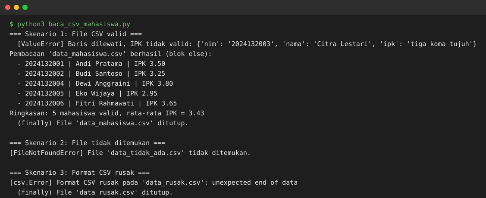
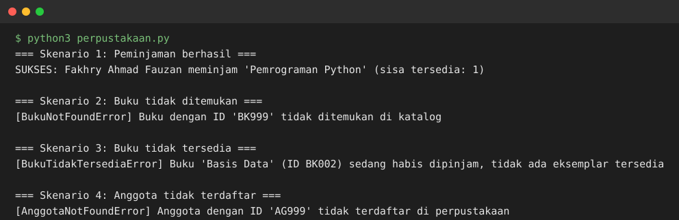
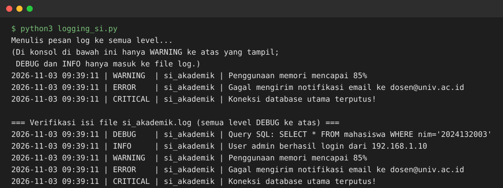
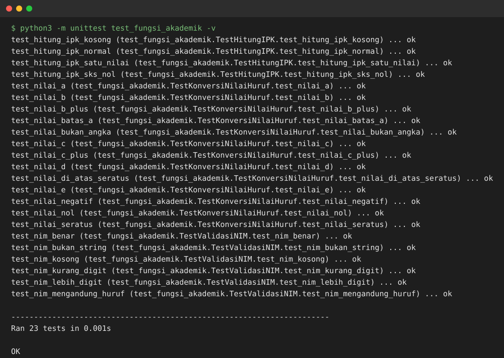
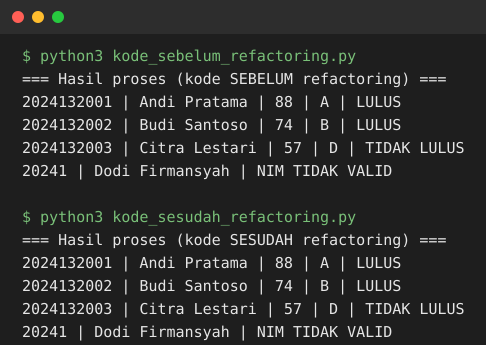
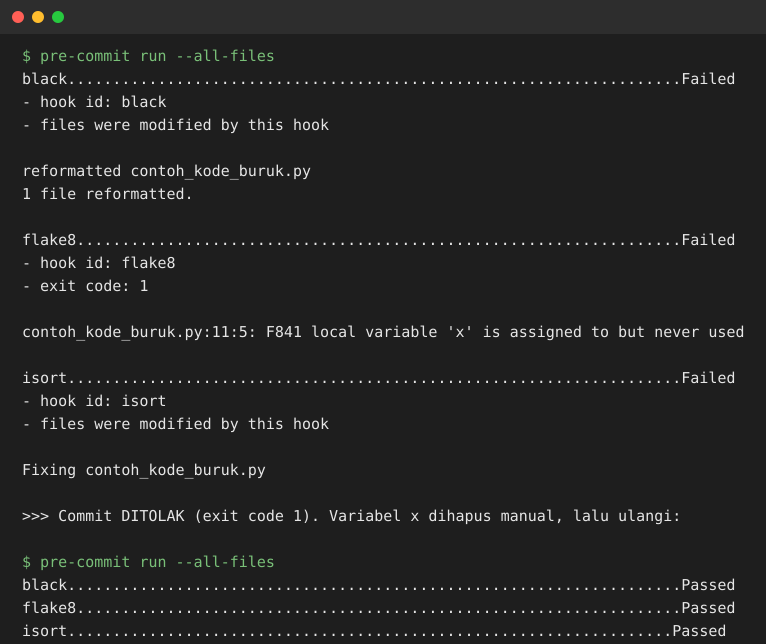

# Screenshot Hasil Praktikum — Pertemuan 7

Screenshot output asli dari menjalankan setiap program soal praktik.
Di GitHub, screenshot ditampilkan dalam format SVG (isi sama persis
dengan versi PNG pada bundle ZIP).

## Soal 1 — Baca CSV dengan Exception Handling

## Soal 2 — Custom Exception Perpustakaan

## Soal 3 — Logging

## Soal 4 — Unit Test (23 test, semua OK)

## Soal 5 — Refactoring (Sebelum vs Sesudah)

## Soal 6 — Pre-commit Hooks

